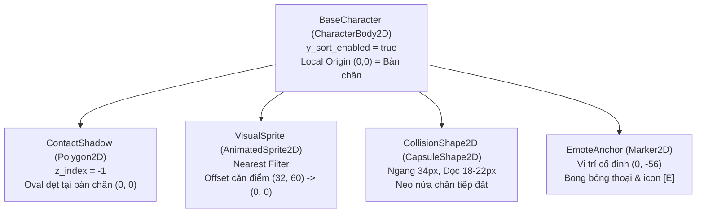
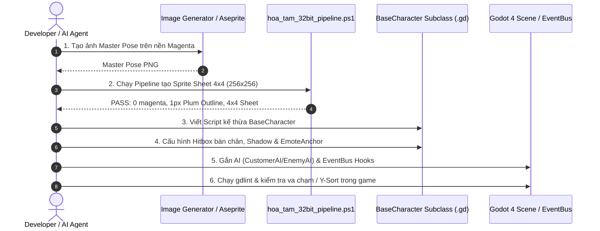

# Lò Thiêng — Master Character Creation & Pipeline Guide
## Quy Chuẩn Toàn Diện Sáng Tạo & Tích Hợp Nhân Vật 32-Bit (Godot 4.x)

> **Tài liệu tham chiếu chuẩn cho Lò Thiêng: Tiếng Gọi Tổ Nghề**
> *Áp dụng bắt buộc cho toàn bộ Nhân vật chính (Player), NPC Cốt truyện, Khách mua hàng (Customers), và Kẻ địch (Enemies).*

---

## Mục Lục
1. [Tổng Quan & Triết Lý Cốt Lõi](#1-tổng-quan--triết-lý-cốt-lõi)
2. [Kiến Trúc Nhân Vật Trong Engine (`BaseCharacter.gd`)](#2-kiến-trúc-nhân-vật-trong-engine-basecharactergd)
   - [Cấu trúc Cây Node Chuẩn (Node Hierarchy)](#cấu-trúc-cây-node-chuẩn-node-hierarchy)
   - [Quy chuẩn Tọa độ Tiếp Đất (Foot Origin Anchor)](#quy-chuẩn-tọa-độ-tiếp-đất-foot-origin-anchor)
   - [Bóng Tiếp Đất (Contact Shadow) & Hitbox](#bóng-tiếp-đất-contact-shadow--hitbox)
   - [Emote & Bong Bóng Thoại (EmoteAnchor)](#emote--bong-bóng-thoại-emoteanchor)
   - [Tích hợp Âm thanh Bước chân (Audio Integration)](#tích-hợp-âm-thanh-bước-chân-audio-integration)
   - [API Tham Chiếu `BaseCharacter.gd`](#api-tham-chiếu-basecharactergd)
3. [Quy Chuẩn Không Gian & Tỷ Lệ Môi Trường (Spatial Metrics)](#3-quy-chuẩn-không-gian--tỷ-lệ-môi-trường-spatial-metrics)
   - [Khung Ô Chuẩn (64×64 Grid Cell)](#khung-ô-chuẩn-6464-grid-cell)
   - [Hệ số Hiển thị `RENDER_SCALE` Theo Môi Trường](#hệ-số-hiển-thị-render_scale-theo-môi-trường)
   - [Tỷ Lệ Môi Trường 3/4 RPG (Environmental Proportions)](#tỷ-lệ-môi-trường-34-rpg-environmental-proportions)
4. [Quy Chuẩn Mỹ Thuật & Animation (Art & Sprite Sheet Spec)](#4-quy-chuẩn-mỹ-thuật--animation-art--sprite-sheet-spec)
   - [Bảng Màu Hoả Tâm 96 Màu (Master Palette)](#bảng-màu-hoả-tâm-96-màu-master-palette)
   - [Quy Chuẩn Sprite Sheet 4 Hướng](#quy-chuẩn-sprite-sheet-4-hướng)
   - [Giải Phẫu Học & Chuyển Động Chân Thú (Cat / Beastfolk Anatomy)](#giải-phẫu-học--chuyển-động-chân-thú-cat--beastfolk-anatomy)
5. [Quy Trình 6 Bước Thêm Mới NPC/Enemy Dưới 10 Phút](#5-quy-trình-6-bước-thêm-mới-npcenemy-dưới-10-phút)
6. [Mẫu Code Hoàn Chỉnh (Production-Ready Templates)](#6-mẫu-code-hoàn-chỉnh-production-ready-templates)
7. [Bảng Xử Lý Sự Cố Thường Gặp (Troubleshooting)](#7-bảng-xử-lý-sự-cố-thường-gặp-troubleshooting)

---

## 1. Tổng Quan & Triết Lý Cốt Lõi

Lò Thiêng vận hành trên phong cách đồ họa **32-bit Hoả Tâm Pixel Art** kết hợp cơ chế nhập vai góc nhìn **3/4 Top-Down RPG**. Mọi thực thể sống trong thế giới đều tuân thủ 3 nguyên tắc bất biến:

1. **100% Nhân vật Động (Movable Entities — Không Tượng Tĩnh):**
   - Mọi thực thể (Nấm, NPC thợ thủ công, khách vào tiệm, quái vật tuần tra) di chuyển xuyên suốt **4 môi trường**: `WorkshopHub`, `ShopScene`, `ExplorationScene`, và `CombatScene`.
   - Tuyệt đối không sử dụng sprite đơn lập tĩnh không có chu kỳ bước đi hoặc không có bóng chân tiếp đất.
2. **Chuẩn Hóa Điểm Neo Bàn Chân (Foot-Centric Anchor):**
   - Gốc tọa độ `(0, 0)` cục bộ của nhân vật luôn nằm tại **chính giữa hai bàn chân tiếp đất**.
   - Mọi tính toán Y-sorting (chiều sâu hiển thị), va chạm vật lý (Collision), và bóng tiếp đất (Contact Shadow) đều tập trung tại bàn chân.
3. **Thống Nhất Tỷ Lệ Không Gian 3/4:**
   - Kích thước nhân vật, đồ nội thất, cửa ra vào và quái vật phải hòa quyện theo tỷ lệ thực tế RPG 3/4 (được cân chỉnh tại Session 131–132). Không để xảy ra tình trạng nhân vật cao vượt cửa hoặc lọt thỏm trước đe rèn.

---

## 2. Kiến Trúc Nhân Vật Trong Engine (`BaseCharacter.gd`)

Để loại bỏ hoàn toàn sự phân mảnh code giữa các scene, tất cả nhân vật trong game kế thừa từ lớp cơ sở dùng chung: `scripts/characters/base_character.gd` (`class_name BaseCharacter extends CharacterBody2D`).

### Cấu trúc Cây Node Chuẩn (Node Hierarchy)

```text
BaseCharacter (CharacterBody2D)                  [y_sort_enabled = true, collision_layer, collision_mask]
├── ContactShadow (Polygon2D)                    [z_index = -1, Oval dẹt, Color(0.06, 0.03, 0.04, 0.42)]
├── VisualSprite (AnimatedSprite2D)              [TEXTURE_FILTER_NEAREST, SpriteFrames, offset căn chân]
├── CollisionShape2D (CapsuleShape2D)            [Neo nửa dưới bàn chân, chống kẹt góc tường/vật cản]
└── EmoteAnchor (Marker2D)                       [Vị trí (0, -56), neo popup thoại, [E], icon !, ?]
```



---

### Quy chuẩn Tọa độ Tiếp Đất (Foot Origin Anchor)

Trong game 2D Top-Down 3/4 có `y_sort_enabled = true`, tọa độ Y toàn cục của Node xác định thứ tự vẽ tầng (Z-Order):
- Thực thể có `position.y` lớn hơn sẽ đứng **đằng trước** (đè lên) thực thể có `position.y` nhỏ hơn.
- Nếu đặt tâm Node ở giữa thân (ngực/bụng), nhân vật sẽ bị lỗi hiển thị: đi sau cái bàn nhưng đầu lại bị bàn che, hoặc đi trước NPC nhưng chân lại bị NPC đè lên.
- **Quy tắc bắt buộc:** Gốc tọa độ `(0, 0)` của `BaseCharacter` **PHẢI** là điểm tiếp xúc giữa bàn chân và mặt sàn.

```
       [ Khung ô sprite 64x64 ]
     +--------------------------+  y = 0
     |         (Đỉnh đầu)       |
     |          / \__/\         |
     |         (  o.o  )        |  y = 20..30 (Thân/Ngực)
     |          \  =  /         |
     |         /|     |\        |
     |        (_|     |_)       |
     |          |  |  |         |
     |          (o) (o)         |  y = 60 (Bàn chân tiếp đất)  <--- Điểm (32, 60)
     +----------======----------+  y = 64 (Đáy ô, chừa 4px lề)
                    |
                    v
    Trùng với Gốc Cục Bộ (0, 0) của BaseCharacter
```

---

### Bóng Tiếp Đất (Contact Shadow) & Hitbox

#### 1. Bóng Tiếp Đất (`ContactShadow`)
- **Loại Node:** `Polygon2D` hình bầu dục (oval dẹt 14–16 đỉnh).
- **Màu sắc:** `Color(0.06, 0.03, 0.04, 0.42)` — màu mực mận sẫm trong suốt, không dùng màu đen tuyền để giữ chất nghệ thuật Hoả Tâm.
- **Tọa độ & Layer:** `position = Vector2(0.0, 0.0)` (hoặc offset nhẹ `+2px` theo góc nghiêng sàn), `z_index = -1` để luôn nằm dưới chân sprite.
- **Kích thước:** Bán kính trục ngang `22–24px`, bán kính trục dọc `7–8px` (ở tỷ lệ phòng `RENDER_SCALE = 3.0` tương đương bán kính thực ~7–8px trong sprite 64×64).
- **Nhịp thở bước chân:** Khi nhân vật sải bước (frame nhấc chân lên cao), code tự động co nhẹ bóng (`scale = Vector2(0.88, 0.88)`) tạo cảm giác cơ thể nâng lên khỏi mặt đất.

#### 2. Va Chạm Vật Lý (`CollisionShape2D`)
- **Hình dáng:** `CapsuleShape2D` nằm ngang hoặc `RectangleShape2D` góc bo tròn.
- **Kích thước chuẩn:**
  - Player (Nấm): Rộng `34px`, Cao `18–22px` (hoặc `44×24px`).
  - NPC / Khách / Quái: Rộng `30–36px`, Cao `16–20px`.
- **Tâm va chạm:** Đặt tại `Vector2(0, -9)` để đáy hitbox nằm chính xác tại `y = 0` (mặt sàn).
- **Lợi ích:** Trọng tâm va chạm chỉ bao bọc bàn chân giúp nhân vật lướt qua các mép bàn, đe rèn và hốc cửa mượt mà; phần thân và đầu tự do che phủ lên đồ vật phía sau đúng phối cảnh 3/4.

---

### Emote & Bong Bóng Thoại (EmoteAnchor)

- **Loại Node:** `Marker2D` đặt tên chính xác là `EmoteAnchor`.
- **Tọa độ chuẩn:** `position = Vector2(0.0, -56.0)` (tương ứng vị trí đỉnh đầu nhân vật).
- **Mục đích:**
  - Điểm neo xuất hiện huy hiệu tương tác `[E]` khi Player lại gần.
  - Điểm neo bong bóng thoại, dấu chấm than `!`, dấu hỏi `?`, hoặc icon cảm xúc (giận dữ, hài lòng của khách mua đồ).
  - Tránh hard-code tọa độ UI nổi trong từng script scene riêng biệt.

---

### Tích hợp Âm thanh Bước chân (Audio Integration)

`BaseCharacter.gd` tích hợp sẵn bộ đếm bước chân đồng bộ theo vận tốc thực tế:
- **Tần suất bước chân:** Sử dụng biến tích lũy quãng đường `_step_distance_accumulator`. Cứ mỗi khi nhân vật di chuyển được quãng đường `STEP_DISTANCE_INTERVAL` (khoảng `64.0–80.0 px` theo scale), một âm thanh bước chân sẽ kích hoạt.
- **SFX luân phiên:** Luân phiên gọi `AudioManager.play_sfx_key("footstep_wood_1")` và `AudioManager.play_sfx_key("footstep_wood_2")` với biến thiên cao độ nhẹ (`pitch_scale = randf_range(0.95, 1.05)`) tạo cảm giác tự nhiên, sống động.

---

### API Tham Chiếu `BaseCharacter.gd`

| Thuộc Tính / Phương Thức | Kiểu Dữ Liệu | Ý Nghĩa & Cách Sử Dụng |
|---|---|---|
| `move_speed` | `float` | Tốc độ di chuyển tối đa (`240.0` trong xưởng/tiệm, `360.0` khi thám hiểm). |
| `move_accel` | `float` | Gia tốc tăng tốc mượt mà (`2400.0 px/s²`). |
| `move_decel` | `float` | Lực hãm khi dừng (`2800.0 px/s²`). |
| `render_scale` | `float` | Tỷ lệ co giãn sprite (`3.0` trong phòng, `2.75` NPC, `1.0` map lớn). |
| `facing_dir` | `String` | Hướng mặt hiện tại: `"down"`, `"up"`, `"right"`, `"left"`. |
| `can_move` | `bool` | Cờ cho phép di chuyển (tự động khóa khi mở menu/hội thoại). |
| `play_anim(anim_name: String)` | `void` | Phát animation; tự động giữ pha bước chân khi xoay hướng. |
| `set_facing(dir: String)` | `void` | Cập nhật hướng mặt và tự động xử lý lật ảnh `flip_h` nếu dùng góc nghiêng. |
| `set_can_move(enable: bool)` | `void` | Bật/tắt khả năng di chuyển của nhân vật. |
| `lock_movement()` | `void` | Triệt tiêu ngay lập tức vận tốc (`velocity = Vector2.ZERO`) và chuyển về idle. |
| `unlock_movement()` | `void` | Mở lại khả năng di chuyển sau khi đóng popup. |
| `move_character(dir: Vector2, delta: float)` | `void` | Di chuyển theo vector hướng với gia tốc mượt và gọi `move_and_slide()`. |
| `setup_sprite_frames(frames: SpriteFrames)` | `void` | Nạp cấu hình animation động từ code hoặc resource. |
| `get_emote_position()` | `Vector2` | Trả về tọa độ toàn cục (`global_position`) của `EmoteAnchor`. |

---

## 3. Quy Chuẩn Không Gian & Tỷ Lệ Môi Trường (Spatial Metrics)

### Khung Ô Chuẩn (64×64 Grid Cell)

- Toàn bộ sprite nhân vật, quái vật và NPC đều được thiết kế và render trên lưới **`64×64 px`**.
- **Điểm chân tiếp xúc chuẩn (Foot Origin):** Tọa độ `X = 32`, `Y = 60` trong khung cell `64×64`.
  - 4px dưới đáy (`y = 61..64`) là vùng đệm chân tiếp đất và bóng đổ nhẹ.
  - Chiều rộng nhân vật hiệu dụng: `32–44 px`. Chiều cao hiệu dụng: `48–56 px`.

---

### Hệ số Hiển thị `RENDER_SCALE` Theo Môi Trường

| Môi Trường | Tệp Script Đại Diện | Độ Phân Giải / Nền | `RENDER_SCALE` Chuẩn | Chiều Cao Trên Màn Hình | Ghi Chú Kỹ Thuật |
|---|---|---|---|---|---|
| **WorkshopHub** (Xưởng rèn) | `scripts/main/workshop_hub.gd` | BG `640×360` × 3 = `1920×1080` | **`3.0×`** (Player)<br>**`2.75×`** (NPC) | Player: ~`170–192 px`<br>NPC: ~`155–165 px` | Khớp tỷ lệ nguyên (integer scaling). Nấm cao ngang ngực đe rèn. |
| **ShopScene** (Cửa tiệm) | `scripts/shop/shop_scene.gd` | BG `640×360` × 3 = `1920×1080` | **`3.0×`** (Player)<br>**`2.75×`** (Khách) | Player: ~`170–192 px`<br>Khách: ~`155–165 px` | Khách mua hàng di chuyển từ cửa tới kệ và quầy thu ngân. |
| **ExplorationScene** (Dungeon / Map mở) | `scripts/regions/exploration_scene.gd` | Tilemap `TILE = 64 px`, Cam `1.5×` | **`1.0×`** | Nhân vật: **`64 px`** | **Bắt buộc scale 1.0!** Camera 1.5x đã phóng to hình ảnh vừa mắt. Tránh lỗi phóng to 15x. |
| **CombatScene** (Đấu trường theo lượt) | `scripts/combat/combat_scene.gd` | Sân đấu `1920×1080` cố định | **`3.0×`** | Đơn vị: ~`192 px` | Rõ nét từng động tác vung kiếm, nảy lùi, trúng đòn. |

---

### Tỷ Lệ Môi Trường 3/4 RPG (Environmental Proportions)

Để đảm bảo thế giới game nhất quán và chân thực, mọi đồ nội thất và công trình đều tuân theo tỷ lệ vàng so với chiều cao nhân vật Nấm (~170px trong xưởng):

```
       [ Cửa Ra Vào: 1.5 - 1.8x ] (~250 - 300px)
       +-------------------------------+
       |                               |
       |                               |
       |     [ Nấm: 1.0x ] (~170px)    |
       |         /\__/\                |
       |        ( o.o  )               |
       |      [ Đe Rèn: 0.5 - 0.6x ]   |
       |      +-------+       |        |
       |      | ~125px|       |        |
       +------|       |-------+--------+
```

1. **Đe Rèn (`Anvil` / `Workbench`): `0.5× – 0.6×` chiều cao nhân vật**
   - Chiều cao đe rèn: `~125 px` (so với Nấm `~170 px`).
   - Đỉnh mặt đe rèn nằm ngang hông đến bụng dưới của Nấm. Khi đứng cạnh đe, tư thế cầm búa gõ phôi thép tạo góc đánh chuẩn xác nhất.
2. **Cửa Ra Vào (`Doorway` / `Archway`): `1.5× – 1.8×` chiều cao nhân vật**
   - Chiều cao cửa: `~250 – 300 px`.
   - Đảm bảo nhân vật có thể bước qua cửa mà không bị cảm giác "cộc đầu" hay quá chật chội.
3. **Bàn Trưng Bày / Kệ Sách / Quầy Tiệm: `0.6× – 0.7×` chiều cao nhân vật**
   - Chiều cao mặt bàn: `~110 – 125 px`. Khách hàng đứng trước quầy vừa tầm quan sát và trao đổi tiền bạc.
4. **Giường Ngủ (`Bed`): Chiều dài `1.8× – 2.0×` chiều cao nhân vật**
   - Đảm bảo khi nhân vật nằm nghỉ ngơi toàn bộ cơ thể nằm trọn trong lòng giường.

---

## 4. Quy Chuẩn Mỹ Thuật & Animation (Art & Sprite Sheet Spec)

### Bảng Màu Hoả Tâm 96 Màu (Master Palette)

Tất cả asset đồ họa nhân vật **bắt buộc** được phối và quantize theo bảng màu Hoả Tâm 96 màu:
- **Đường Viền (Sealing Outline):** `1px` màu **Mực Mận Sẫm (`#120C10`)**.
  - **NGHIÊM CẤM** dùng màu đen tuyền (`#000000`) vì sẽ gây đứt gãy phong cách pixel art cổ điển.
  - Viền ngoài bao bọc toàn bộ chu vi sprite để nổi bật trên mọi nền sàn (gỗ sáng, đá tối, lò lửa rực).
- **Tông Màu Cơ Bản:**
  - Da lông / Thân thể: Nâu hạt dẻ (`#4A2E1B`), Vàng đất ấm (`#A66B38`), Trắng kem (`#F4E8D1`).
  - Trang phục / Tạp dề: Da bò thuộc (`#7C3F1D`), Vải thô Chàm (`#2C3E50`), Khăn quàng Đỏ Đất (`#8E2818`).
  - Kim loại / Vũ khí: Đồng xước ấm (`#B87333`), Thép tôi sáng (`#D5E1DF`), Ánh than hồng rực (`#FF5722`).
- **Nền Tách Lớp (Chroma-Key):** Màu Magenta thuần túy `RGB(255, 0, 255)` (`#FF00FF`). Tỷ lệ lem màu cho phép sau khi qua pipeline: **0 pixel**.

---

### Quy Chuẩn Sprite Sheet 4 Hướng

#### A. Chuẩn NPC, Khách Hàng & Kẻ Địch (Lưới 4×4 — `256×256 px`)
Sprite sheet gồm 4 cột × 4 hàng ô `64×64 px`:

| Hàng (Row) | Tên Animation | Số Frame | FPS Chuẩn | Vòng Lặp (Loop) | Mô Tả Chuyển Động |
|---|---|---|---|---|---|
| **`Row 0`** | `idle` | 4 | `6.0` | `true` | Đứng thở tự nhiên, nhấp nhô ngực 1px, đuôi/tai khẽ lay. |
| **`Row 1`** | `walk` | 4 | `10.0` | `true` | Bước chân 4 pha (Chạm chân trái → Bước qua → Chạm chân phải → Bước qua). Cơ thể nhấp nhô (bob) 1px ở pha chạm chân. |
| **`Row 2`** | `attack` | 4 | `10.0` | `false` | Tích lực vung vũ khí / cử chỉ tương tác hoặc đưa tay chào hàng. |
| **`Row 3`** | `hurt` | 4 | `10.0` | `false` | Nảy lùi lại phía sau, nháy sáng đỏ/trắng khi trúng đòn hoặc sốt ruột. |

#### B. Chuẩn Nhân Vật Chính `Nấm` (Lưới 16×14 — `1024×896 px` Chuẩn Điện Ảnh)
Dành riêng cho nhân vật chính Nấm để đạt độ mượt mà cao nhất khi di chuyển 4 hướng:
- `Row 0..3`: `idle_down`, `idle_up`, `idle_right`, `idle_left` (16 frame @ `12.0 FPS`, loop — thở nhịp nhàng, chớp mắt, đuôi vẫy hình chữ S).
- `Row 4..7`: `walk_down`, `walk_up`, `walk_right`, `walk_left` (16 frame @ `24.0 FPS`, loop — khớp 2 đoạn chân IK, hạ gót nhón ngón, tà tạp dề rủ tự nhiên).
- `Row 8..11`: `run_down`, `run_up`, `run_right`, `run_left` (16 frame @ `28.0 FPS`, loop — bước chạy tốc độ cao).
- `Row 12`: `hurt` (8 frame @ `16.0 FPS`, non-loop).
- `Row 13`: `special` / `attack` (8 frame @ `18.0 FPS`, non-loop).

---

### Giải Phẫu Học & Chuyển Động Chân Thú (Cat / Beastfolk Anatomy)

Từ những bài học khắc phục khuyết tật bước chân của Nấm trong các phiên bản trước, quy chuẩn tạo hình động vật hình người (Animal Folk / Cat Folk) bắt buộc tuân thủ:

```
            [ CẤU TRÚC CHÂN DIGITIGRADE CHUẨN ]
               (Hông / Đùi trên)
                     o
                    /   <--- Đùi cơ bắp dày (7px)
                   /
                  o     <--- Khớp gối (Knee)
                   \
                    \   <--- Cẳng chân bẻ ngược về sau (5px)
                     o  <--- Khớp gót chân (Hock Joint) nằm trên cao!
                     |
                     o  <--- Bàn chân & đệm móng (Paws với 3 ngón kem)
```

1. **Khớp Chân Bước Bằng Ngón (Digitigrade Legs):**
   - Không vẽ ống chân thẳng đứng như người (Plantigrade) hoặc hình que củi đơn giản.
   - Bắt buộc có **khớp gót chân bẻ ngược về sau (hock joint)** nằm cao trên cẳng chân.
   - Đùi dày cơ bắp `~7px`, cẳng chân `~5px`, bàn chân đệm móng êm ái `8×3px` có điểm nhấn 3 ngón màu kem.
2. **Tà Tạp Dề & Quần Áo Treo Rủ Tự Nhiên:**
   - Tạp dề da thợ rèn là một mảng nguyên vẹn rủ theo trọng lực.
   - Khi bước đi nhìn từ phía trước (`walk_down`): **tuyệt đối không cắt đôi xẻ dọc tạp dề**. Tà áo chỉ gợn sóng nhịp nhàng theo chuyển động đùi.
3. **Đuôi Mèo Hình Chữ S Hữu Cơ:**
   - Đuôi bắt nguồn từ gốc xương cùng (hip base), uốn lượn đường cong chữ S mềm mại.
   - Ở góc nhìn sau lưng (`walk_up`): **chỉ tồn tại 1 đuôi động duy nhất**. Loại bỏ triệt để phần đuôi tĩnh gắn ở thân để không bị lỗi 2 đuôi (Double Tail Bug).

---

## 5. Quy Trình 6 Bước Thêm Mới NPC/Enemy Dưới 10 Phút

Thực hiện theo đúng 6 bước chuẩn hóa này để đưa một nhân vật mới vào game hoàn chỉnh:



### Bước 1 (1.5 phút): Chuẩn Bị Ảnh Master Pose Gốc
Tạo hoặc xuất 1 ảnh đơn của nhân vật đứng tư thế 3/4 trên nền Magenta `#FF00FF` thuần:
- **Tư thế:** Toàn thân đứng thẳng, 2 bàn chân đặt trên cùng một đường thẳng chân tiếp xúc.
- **Phong cách:** 32-bit pixel art, viền mực mận sẫm `#120C10`, màu sắc thuộc bảng Hoả Tâm.
- **Góc mặt:** Hướng sang **TRÁI** (đối với NPC/Quái vật) hoặc sang **PHẢI** (đối với Player).
- **Lưu file:** `assets/pixel/sprites/<category>/raw/<name>_raw.png`.

### Bước 2 (1.5 phút): Chạy Pipeline Tự Động Tạo Sprite Sheet
Mở terminal PowerShell trong thư mục gốc dự án và chạy lệnh:

```powershell
powershell -ExecutionPolicy Bypass -File .agents\skills\lo-thieng-pixel-assets\scripts\hoa_tam_32bit_pipeline.ps1 `
    -Mode sheetFromSingle `
    -InputPath "assets/pixel/sprites/npcs/raw/tho_san_raw.png" `
    -OutputPath "assets/pixel/sprites/npcs/tho_san_sheet_64.png" `
    -CellSize 64 `
    -FacingSign -1
```

*Kết quả đầu ra hợp lệ khi console in dòng: `PASS: 256x256, 0 magenta spill, valid frames`.*

### Bước 3 (1.5 phút): Tạo Script Kế Thừa `BaseCharacter`
Tạo file script mới: `scripts/npc/tho_san_npc.gd`:

```gdscript
class_name ThoSanNPC
extends BaseCharacter

const SHEET_PATH := "res://assets/pixel/sprites/npcs/tho_san_sheet_64.png"

func _ready() -> void:
	render_scale = 2.75 # Tỷ lệ chuẩn cho NPC trong WorkshopHub/ShopScene
	super._ready()
	_load_npc_animations(SHEET_PATH)
```

### Bước 4 (2.0 phút): Nạp SpriteFrames Chuẩn 4×4
Thêm hàm nạp frame tự động trong script:

```gdscript
func _load_npc_animations(path: String) -> void:
	var tex := load(path) as Texture2D
	if tex == null:
		push_error("Không tìm thấy sprite sheet: " + path)
		return

	var frames := SpriteFrames.new()
	var defs: Array[Dictionary] = [
		{"name": "idle",   "row": 0, "count": 4, "fps": 6.0,  "loop": true},
		{"name": "walk",   "row": 1, "count": 4, "fps": 10.0, "loop": true},
		{"name": "attack", "row": 2, "count": 4, "fps": 10.0, "loop": false},
		{"name": "hurt",   "row": 3, "count": 4, "fps": 10.0, "loop": false},
	]

	for d: Dictionary in defs:
		var anim: String = d["name"]
		var r: int = d["row"]
		frames.add_animation(anim)
		frames.set_animation_speed(anim, d["fps"])
		frames.set_animation_loop(anim, d["loop"])
		for c in int(d["count"]):
			var atlas := AtlasTexture.new()
			atlas.atlas = tex
			atlas.region = Rect2(c * 64, r * 64, 64, 64)
			frames.add_frame(anim, atlas)

	setup_sprite_frames(frames)
	play_anim("idle")
```

### Bước 5 (2.0 phút): Gắn Vùng Tương Tác (Area2D) & Emote
Thêm vùng phát hiện người chơi lại gần để kích hoạt hội thoại hoặc icon `[E]`:

```gdscript
func _setup_interaction() -> void:
	var area := Area2D.new()
	area.name = "InteractionArea"
	var col := CollisionShape2D.new()
	var circle := CircleShape2D.new()
	circle.radius = 48.0
	col.shape = circle
	area.add_child(col)
	area.body_entered.connect(func(b): if b is CharacterBody2D: _show_prompt(true))
	area.body_exited.connect(func(b): if b is CharacterBody2D: _show_prompt(false))
	add_child(area)
```

### Bước 6 (1.5 phút): Kiểm Tra & Xác Nhận Chất Lượng
1. Chạy linter cú pháp:
   ```bash
   gdlint scripts/npc/tho_san_npc.gd
   ```
2. Mở Scene kiểm tra hoặc chạy `smoke_test.gd`.
3. Kiểm tra hiển thị:
   - Chân đứng chạm đất tự nhiên, không bị lơ lửng.
   - Bóng đổ `ContactShadow` nằm ngay dưới lòng bàn chân.
   - Khi Player đi qua mặt trước/mặt sau NPC, hiệu ứng `y_sort` che khuất chính xác.

---

## 6. Mẫu Code Hoàn Chỉnh (Production-Ready Templates)

### A. Lớp Cơ Sở Hoàn Chỉnh: `scripts/characters/base_character.gd`

```gdscript
class_name BaseCharacter
extends CharacterBody2D

signal animation_finished(anim_name: String)
signal footstep_sound_played

const DEFAULT_MOVE_SPEED := 240.0
const MOVE_ACCEL := 2400.0
const MOVE_DECEL := 2800.0
const STOP_SPEED_THRESHOLD := 20.0
const STEP_DISTANCE_INTERVAL := 72.0

@export var move_speed: float = DEFAULT_MOVE_SPEED
@export var render_scale: float = 3.0
@export var can_move: bool = true

var facing_dir: String = "down"

var _sprite: AnimatedSprite2D
var _shadow: Polygon2D
var _col_shape: CollisionShape2D
var _emote_anchor: Marker2D

var _step_distance_acc: float = 0.0
var _step_toggle: bool = false


func _ready() -> void:
	y_sort_enabled = true
	physics_interpolation_mode = Node.PHYSICS_INTERPOLATION_MODE_INHERIT

	_shadow = _build_contact_shadow()
	add_child(_shadow)

	_sprite = _build_visual_sprite()
	add_child(_sprite)

	_col_shape = _build_collision_shape()
	add_child(_col_shape)

	_emote_anchor = Marker2D.new()
	_emote_anchor.name = "EmoteAnchor"
	_emote_anchor.position = Vector2(0.0, -56.0)
	add_child(_emote_anchor)


func _physics_process(delta: float) -> void:
	if not can_move:
		velocity = velocity.move_toward(Vector2.ZERO, MOVE_DECEL * delta)
		move_and_slide()
		return

	var speed := velocity.length()
	if speed > 10.0:
		_process_footstep_audio(speed * delta)


func move_character(input_dir: Vector2, delta: float) -> void:
	if not can_move or input_dir == Vector2.ZERO:
		velocity = velocity.move_toward(Vector2.ZERO, MOVE_DECEL * delta)
	else:
		var target_vel := input_dir.normalized() * move_speed
		velocity = velocity.move_toward(target_vel, MOVE_ACCEL * delta)
		set_facing(_resolve_direction_string(input_dir))

	move_and_slide()
	_update_locomotion_animation()


func lock_movement() -> void:
	can_move = false
	velocity = Vector2.ZERO
	play_anim("idle")


func unlock_movement() -> void:
	can_move = true


func set_can_move(enable: bool) -> void:
	can_move = enable
	if not enable:
		lock_movement()


func set_facing(dir: String) -> void:
	if dir == "":
		return
	facing_dir = dir
	if _sprite == null:
		return

	if dir == "left":
		# Nếu sprite có animation riêng thì dùng, không thì lật ngang từ right
		if _sprite.sprite_frames != null and _sprite.sprite_frames.has_animation("walk_left"):
			_sprite.flip_h = false
		else:
			_sprite.flip_h = true
	elif dir == "right":
		_sprite.flip_h = false


func play_anim(anim_name: String) -> void:
	if _sprite == null or _sprite.sprite_frames == null:
		return
	if not _sprite.sprite_frames.has_animation(anim_name):
		# Fallback về animation cơ bản nếu thiếu animation 4 hướng
		if anim_name.begins_with("walk_") and _sprite.sprite_frames.has_animation("walk"):
			anim_name = "walk"
		elif anim_name.begins_with("idle_") and _sprite.sprite_frames.has_animation("idle"):
			anim_name = "idle"
		else:
			return

	if _sprite.animation == anim_name and _sprite.is_playing():
		return

	var prev_frame := _sprite.frame
	var prev_progress := _sprite.frame_progress
	var was_walk := _sprite.animation.contains("walk")
	var is_walk := anim_name.contains("walk")

	_sprite.play(anim_name)
	if was_walk and is_walk:
		_sprite.set_frame_and_progress(prev_frame, prev_progress)


func setup_sprite_frames(frames: SpriteFrames) -> void:
	if _sprite != null:
		_sprite.sprite_frames = frames


func get_emote_position() -> Vector2:
	return _emote_anchor.global_position if _emote_anchor != null else global_position


func _build_contact_shadow() -> Polygon2D:
	var poly := Polygon2D.new()
	poly.name = "ContactShadow"
	poly.color = Color(0.06, 0.03, 0.04, 0.42)
	poly.position = Vector2(0.0, 0.0)
	poly.z_index = -1

	var pts := PackedVector2Array()
	var segs := 14
	var rx := 22.0
	var ry := 7.0
	for i in segs:
		var ang := (float(i) / float(segs)) * TAU
		pts.append(Vector2(cos(ang) * rx, sin(ang) * ry))
	poly.polygon = pts
	return poly


func _build_visual_sprite() -> AnimatedSprite2D:
	var sprite := AnimatedSprite2D.new()
	sprite.name = "VisualSprite"
	sprite.texture_filter = CanvasItem.TEXTURE_FILTER_NEAREST
	# Khớp điểm chân (32, 60) trong ô 64x64 trùng đúng (0,0) sàn:
	# Tọa độ tâm cell gốc là (32, 32) -> offset = (32 - 32, 32 - 60) = (0, -28)
	sprite.offset = Vector2(0.0, -28.0)
	sprite.scale = Vector2(render_scale, render_scale)
	return sprite


func _build_collision_shape() -> CollisionShape2D:
	var col := CollisionShape2D.new()
	col.name = "FootCollisionShape"
	var capsule := CapsuleShape2D.new()
	capsule.radius = 9.0
	capsule.height = 34.0
	col.shape = capsule
	col.rotation_degrees = 90.0
	# Đặt tâm tại y = -9 để cạnh đáy capsule chạm đúng y = 0
	col.position = Vector2(0.0, -9.0)
	return col


func _update_locomotion_animation() -> void:
	var speed := velocity.length()
	if speed < STOP_SPEED_THRESHOLD:
		var target_idle := "idle_" + facing_dir
		play_anim(target_idle if _has_anim(target_idle) else "idle")
		if _shadow != null:
			_shadow.scale = Vector2.ONE
	else:
		var target_walk := "walk_" + facing_dir
		play_anim(target_walk if _has_anim(target_walk) else "walk")
		if _shadow != null and _sprite != null:
			var f := _sprite.frame % 4
			var s := 0.88 if (f == 1 or f == 3) else 1.0
			_shadow.scale = Vector2(s, s)


func _process_footstep_audio(dist_moved: float) -> void:
	_step_distance_acc += dist_moved
	if _step_distance_acc >= STEP_DISTANCE_INTERVAL:
		_step_distance_acc = 0.0
		_step_toggle = not _step_toggle
		var sfx_key := "footstep_wood_1" if _step_toggle else "footstep_wood_2"
		if Engine.has_singleton("AudioManager") or has_node("/root/AudioManager"):
			var am := get_node_or_null("/root/AudioManager")
			if am != null and am.has_method("play_sfx_key"):
				am.play_sfx_key(sfx_key, 0.75, randf_range(0.95, 1.05))
		footstep_sound_played.emit()


func _resolve_direction_string(v: Vector2) -> String:
	if absf(v.x) >= absf(v.y):
		return "right" if v.x > 0.0 else "left"
	return "down" if v.y > 0.0 else "up"


func _has_anim(anim_name: String) -> bool:
	return _sprite != null and _sprite.sprite_frames != null and _sprite.sprite_frames.has_animation(anim_name)
```

---

### B. Mẫu Kế Thừa: `PlayerShop` (`scripts/shop/player_shop.gd`)

```gdscript
class_name PlayerShop
extends BaseCharacter

# Kế thừa toàn bộ logic di chuyển, va chạm, âm thanh bước chân và bóng tiếp đất từ BaseCharacter.
# Chỉ bổ sung việc đọc phím bấm người chơi (Input mapping).

func _ready() -> void:
	move_speed = 360.0
	render_scale = 3.0
	super._ready()
	_load_player_custom_frames()


func _physics_process(delta: float) -> void:
	if can_move:
		var input_vec := _read_movement_input()
		move_character(input_vec, delta)
	super._physics_process(delta)


func _read_movement_input() -> Vector2:
	var x := 0.0
	var y := 0.0
	if Input.is_action_pressed("move_left") or Input.is_key_pressed(KEY_A) or Input.is_key_pressed(KEY_LEFT):
		x -= 1.0
	if Input.is_action_pressed("move_right") or Input.is_key_pressed(KEY_D) or Input.is_key_pressed(KEY_RIGHT):
		x += 1.0
	if Input.is_action_pressed("move_up") or Input.is_key_pressed(KEY_W) or Input.is_key_pressed(KEY_UP):
		y -= 1.0
	if Input.is_action_pressed("move_down") or Input.is_key_pressed(KEY_S) or Input.is_key_pressed(KEY_DOWN):
		y += 1.0

	var v := Vector2(x, y)
	return v.normalized() if v.length_squared() > 0.0 else Vector2.ZERO
```

---

## 7. Bảng Xử Lý Sự Cố Thường Gặp (Troubleshooting)

| Hiện Tượng / Bug | Nguyên Nhân Cốt Lõi | Cách Khắc Phục Chuẩn Xác |
|---|---|---|
| **Nhân vật lơ lửng trên mặt sàn** | `sprite.offset` chưa được căn chỉnh để đưa điểm `(32, 60)` về `(0, 0)`. | Chỉnh `sprite.offset = Vector2(0.0, -28.0)`. Không chỉnh `sprite.position`. |
| **Bị che khuất ngược (đứng trước nhưng bị đồ vật sau đè)** | `y_sort_enabled` chưa được bật trên node cha hoặc Node gốc bị lệch Y. | Đảm bảo `y_sort_enabled = true` trên cả Node cha (WorkshopHub) và BaseCharacter. Gốc node phải ở bàn chân. |
| **Kẹt cứng ở góc đe rèn / cửa ra vào** | Hitbox va chạm quá to hoặc bao bọc cả đầu và ngực. | Giữ nguyên `CapsuleShape2D` ngang `34×18px` neo sát chân, không dùng `RectangleShape2D` trùm kín toàn thân. |
| **Sprite bị nhòe mờ khi phóng to** | Bộ lọc texture đang ở chế độ Linear. | Đặt `sprite.texture_filter = CanvasItem.TEXTURE_FILTER_NEAREST` trong `_ready()`. |
| **Viền tím Magenta `#FF00FF` quanh nhân vật** | Quá trình khử nền chưa triệt tiêu lề mờ 1-2px. | Chạy lại pipeline qua [hoa_tam_32bit_pipeline.ps1](../.agents/skills/lo-thieng-pixel-assets/scripts/hoa_tam_32bit_pipeline.ps1), script tự động áp dụng bộ lọc co lề 2px và quét sạch viền magenta. |
| **Chuyển động chân cứng như que củi (Mannequin Legs)** | Khớp chân bị vẽ theo dạng hình trụ thẳng không có góc hock joint. | Tái tạo lại hoạt ảnh theo cấu trúc Digitigrade: đùi cong 7px, khớp gót chân bẻ sau 5px, bàn chân có đệm móng. |
| **Xuất hiện 2 đuôi khi nhìn từ phía sau (`walk_up`)** | Đuôi tĩnh trên thân gốc chưa được xóa khi ghép đuôi động. | Xóa sạch phần đuôi tĩnh trên layer torso trước khi gắn khớp nối đuôi 12 đoạn chuyển động. |
| **Nhân vật bị phóng to 15× ở Map Thám Hiểm** | Tệp scene thám hiểm áp dụng scale nhân đôi lên Player node. | Đặt `_player.scale = Vector2(1.0, 1.0)` trong `scripts/regions/exploration_scene.gd` vì bản đồ thám hiểm đã có Camera zoom 1.5×. |

---

> *Tài liệu được phê chuẩn bởi Swarm Architecture Team — Lò Thiêng.*
> *Mọi cập nhật sửa đổi phải tuân thủ chuẩn `gdlint` và kiểm tra xác thực `git diff --check`.*
